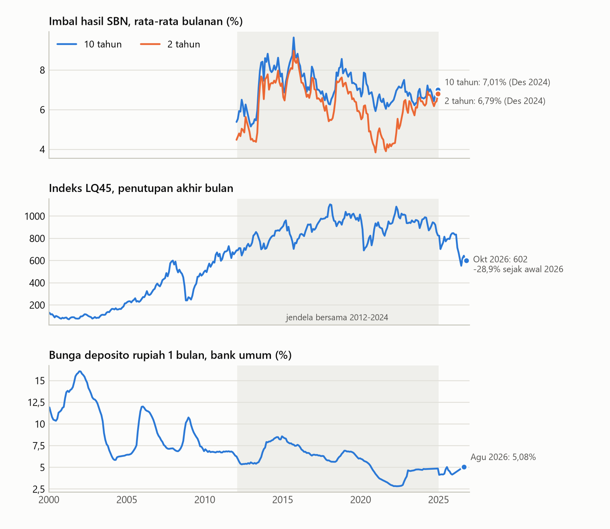
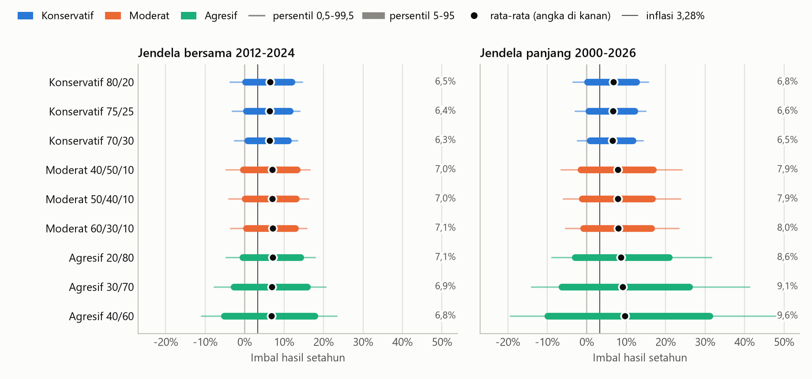
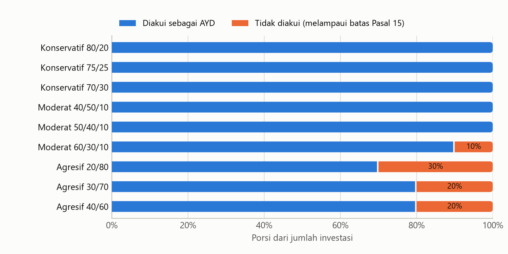
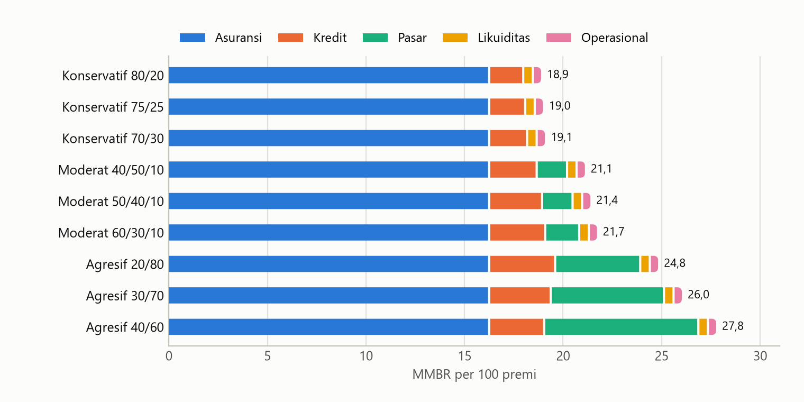
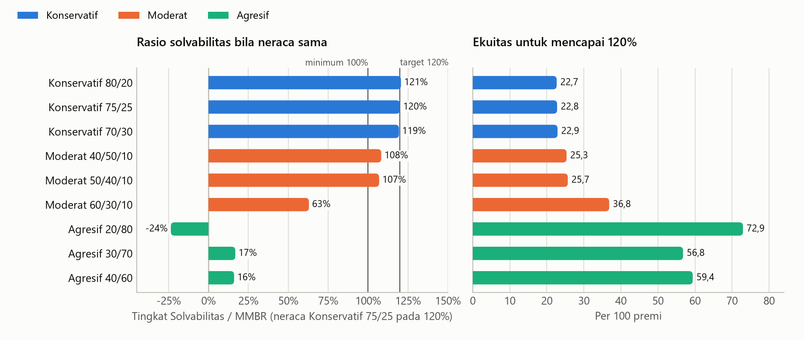
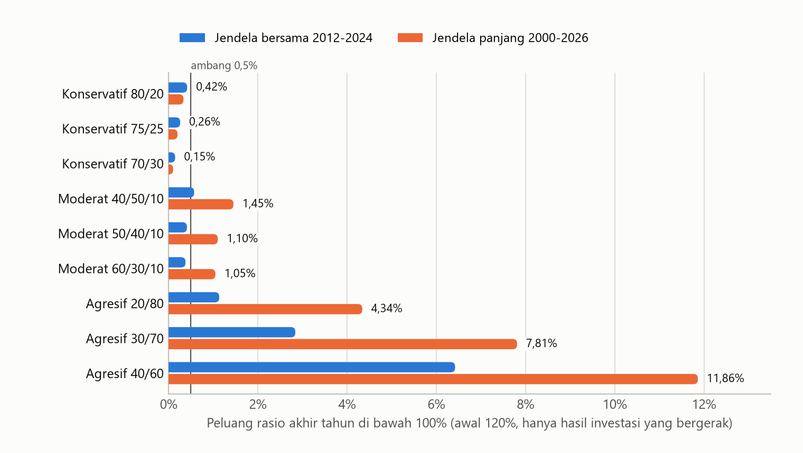
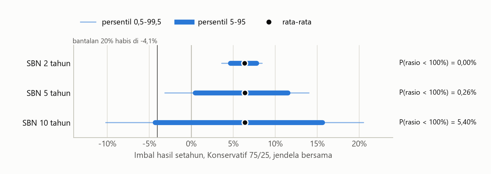
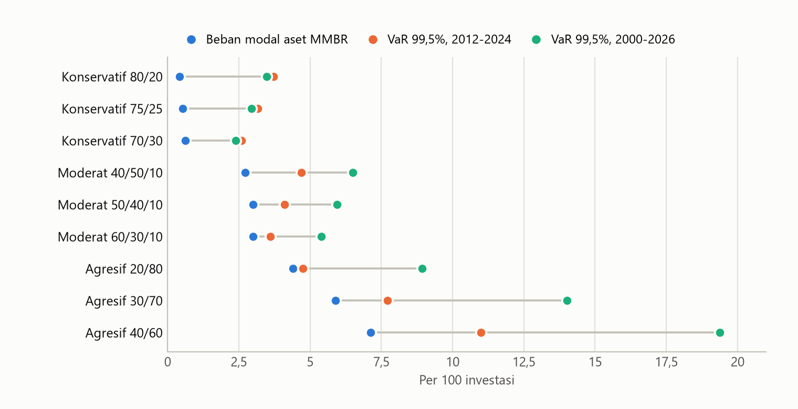

# Analisis Hasil Investasi dan MMBR PT Aktu Proteksi

Kondisi pasar per 2026-10-09. Simulasi 100.000 tahun. Nilai neraca dinyatakan per 100 premi dicatat penutupan langsung setahun.

Dokumen ini mencakup dua dari tiga submodel pada alur metode: model hasil investasi dan perhitungan MMBR. Model kerugian bencana ditahan, jadi semua kesimpulan di sini berlaku untuk risiko investasi dan kebutuhan modal menurut regulasi saja. Angka di dokumen ini diisi otomatis dari `keluaran/hasil.json`; jangan disunting dengan tangan (lihat Lampiran B).

## 1. Ringkasan

**Jawaban sementara untuk soal 1: profil Konservatif, dengan SBN bertenor paling panjang 5 tahun.** Enam ukuran yang mendasarinya:

| Ukuran | Konservatif | Moderat | Agresif |
| --- | --- | --- | --- |
| Patuh batas AYD (Pasal 15 POJK 26/2025) | Seluruh rentang | Hanya bila obligasi korporasi paling tinggi 50% | Tidak; 20% sampai 30% investasi tidak diakui |
| Beban modal aset per 100 investasi (SEOJK 24/2017, AAA sampai AA) | 0,24 sampai 0,63 | 2,24 sampai 3,00 | 3,80 sampai 7,12 |
| Ekuitas untuk rasio 120%, per 100 premi | 22,7 sampai 22,9 | 25,3 sampai 36,8 | 56,8 sampai 72,9 |
| Imbal hasil rata-rata setahun | 6,3% sampai 6,5% | 7,0% sampai 7,1% | 6,8% sampai 7,1% |
| Peluang rasio jatuh di bawah 100% karena investasi saja | 0,15% sampai 0,42% | 0,38% sampai 0,57% | 1,13% sampai 6,42% |
| Aset siap cair per 100 premi | 93 sampai 95 | 36 sampai 51 | 7 |

Baris kelima dihitung pada jendela data 2012-2024, dengan rasio awal 120% dan hasil underwriting ditahan nol. Ambang yang dipakai alur metode adalah 0,5%.

Empat hal yang perlu diketahui sebelum memakai hasil ini:

1. **Tenor SBN menentukan lebih banyak daripada pilihan 80/20 atau 70/30.** Dengan SBN 10 tahun, peluang pelanggaran profil Konservatif naik menjadi 5,40%, lebih buruk daripada profil Moderat. Dengan SBN 2 tahun peluangnya 0,00%.
2. **Profil Moderat dengan obligasi korporasi 40% sampai 50% adalah pesaing terdekat.** Imbal hasilnya 0,66 poin persentase lebih tinggi. Ia kalah pada jendela data panjang (peluang pelanggaran 1,10%), tidak punya deposito, dan risiko kreditnya kurang-taksir di model ini.
3. **Bantalan 20% tipis.** Untuk profil Konservatif 75/25 bantalan itu 3,80 per 100 premi. Kerugian investasi 1-dalam-200 tahun saja memakai 78% darinya. Ini masukan untuk soal 4.
4. **Risiko asuransi mengisi 76% sampai 86% MMBR** pada varian yang patuh. Ini masukan untuk soal 3, baru dari sisi besaran.

Yang belum bisa dijawab di sini: peluang pelanggaran gabungan (investasi dan bencana), komposisi akhir di dalam rentang Konservatif, dan target solvabilitas yang memadai. Ketiganya menunggu model kerugian bencana.

## 2. Kaitan dengan kasus

Brief meminta empat hal yang disentuh analisis ini. Tabel berikut menunjukkan bagian mana menjawab apa, supaya analisis tidak keluar dari yang diminta.

| Yang diminta brief atau panduan | Yang dikerjakan di sini | Bagian |
| --- | --- | --- |
| Soal 1: profil mana yang paling sesuai kondisi ekonomi saat ini | Kepatuhan AYD, beban modal, sebaran imbal hasil, peluang pelanggaran, dan likuiditas untuk sembilan varian dari tiga profil | 5, 6, 7, 8 |
| Ketentuan C.5: tidak boleh mengusulkan alokasi di luar tabel | Semua varian adalah titik ujung atau titik tengah rentang brief | 5.3 |
| Latar belakang: inflasi | Imbal hasil riil terhadap inflasi 3,28% | 5.3 |
| Latar belakang: suku bunga acuan | Kurva imbal hasil 9 Oktober 2026 sebagai titik awal; risiko kenaikan lanjutan lewat bootstrap dan skenario; tenor SBN | 4, 5.5, 8.2 |
| Latar belakang: daya beli masyarakat | Tidak dimodelkan sebagai angka. Dibaca sebagai tekanan arus kas (premi harta benda turun 13,6% dan klaimnya naik 75,8% pada semester I 2026), sehingga likuiditas menjadi kriteria | 7.6 |
| Latar belakang: profil risiko pemegang polis | Tidak dimodelkan sebagai angka. Dibaca sebagai kebutuhan kepastian bayar klaim, sehingga ukuran keputusannya peluang rasio jatuh di bawah 100% | 8.1 |
| Soal 3: modul MMBR dengan kemungkinan tertinggi | Besaran kelima modul per varian. Kemungkinan tiap modul menunggu model bencana | 7.3 |
| Soal 4: kecukupan target 120% | Ukuran bantalan 20%, porsi yang terpakai risiko investasi, dan risiko yang tidak tertangkap rumus MMBR | 8.1, 8.3 |
| Soal 2: mitigasi klaim massal tanpa reasuransi | Hanya satu masukan: aset siap cair per profil | 7.6 |
| Referensi brief: SEOJK 24/2017 | Kelima modul dihitung menurut lampirannya | 7 |
| Panduan Bab 3: analisis deskriptif, hasil pemodelan, interpretasi | Bagian 4 (data), 5 sampai 8 (hasil), 9 (interpretasi per soal) | - |

## 3. Dasar regulasi

Teks kedua peraturan dibaca langsung dari `referensi/regulasi`. Rujukan lengkap per angka ada di `parameter/regulasi.yaml`.

| Ketentuan | Isi | Perlakuan di model |
| --- | --- | --- |
| POJK 26/2025 Pasal 3 ayat (1) | Tingkat Solvabilitas paling rendah 100% MMBR; target internal paling rendah 120% dengan memperhitungkan profil risiko dan stress test | Neraca tiap varian disusun tepat pada 120%, lalu diuji |
| POJK 26/2025 Pasal 1 angka 12 | Tingkat Solvabilitas = AYD dikurangi Liabilitas | Pembilang rasio |
| POJK 26/2025 Pasal 4 ayat (1) | MMBR memperhitungkan risiko kredit, likuiditas, pasar, asuransi, operasional | Lima modul |
| POJK 26/2025 Pasal 5 ayat (1) dan penjelasannya | Prinsip kehati-hatian: keamanan, imbal hasil optimal, kebutuhan likuiditas, profil liabilitas | Empat ukuran pembanding profil |
| POJK 26/2025 Pasal 15 | Batas AYD investasi: deposito 20% per bank; obligasi korporasi 20% per emiten dan 50% seluruhnya; saham 10% per emiten dan 40% seluruhnya; reksa dana 20% per manajer investasi dan 50% seluruhnya; gabungan huruf d sampai m 80%; SBN tanpa batas | Porsi di atas batas tidak dihitung sebagai AYD |
| POJK 26/2025 Pasal 8 | SBN boleh direpokan untuk menjaga likuiditas | SBN masuk aset siap cair setelah potongan |
| POJK 26/2025 Pasal 25 ayat (2) huruf b | Tagihan premi diakui bila berumur paling lama 2 bulan | Tagihan premi = dua bulan premi |
| POJK 26/2025 Pasal 34 | AYD investasi ditambah kas paling sedikit sebesar cadangan teknis dan liabilitas klaim retensi sendiri | Uji kecukupan investasi |
| POJK 26/2025 Pasal 55 dan 56 | Dana jaminan wajib berupa deposito atau SBN | Uji ketersediaan per profil |
| POJK 26/2025 Pasal 85 | Peraturan pelaksana POJK 71/2016 tetap berlaku sepanjang tidak bertentangan | SEOJK 24/2017 tetap menjadi dasar MMBR |
| SEOJK 24/2017 Lampiran II angka 1 | Risiko kredit: SBN 0%; deposito 1,2% sampai 9% menurut peringkat bank; obligasi korporasi 1,6% sampai 12%; tagihan premi 8% | Modul kredit |
| SEOJK 24/2017 Lampiran II angka 2 | Risiko likuiditas: 4% dari kekurangan AYD terhadap liabilitas pada tiap kelompok jatuh tempo | Modul likuiditas |
| SEOJK 24/2017 Lampiran II angka 3 | Risiko pasar: saham IDX30 15%, saham lain 20%; reksa dana ekuitas 16%; risiko tingkat bunga hanya atas cadangan premi jangka panjang | Modul pasar. Obligasi tidak dibebani risiko suku bunga |
| SEOJK 24/2017 Lampiran II angka 4 | Risiko asuransi harta benda: 25% CAPYBMP, 20% cadangan klaim, 25% cadangan bencana, neto reasuransi | Modul asuransi |
| SEOJK 24/2017 Lampiran II angka 5 | Risiko operasional: 1% beban umum dan administrasi setelah dikurangi pendidikan dan pelatihan, ditambah 50% biaya akuisisi ditangguhkan | Modul operasional |

Satu hal berupa tafsir: Pasal 15 tidak menyebut akibat pelampauan batas. Model memperlakukan kelebihannya sebagai aset yang tidak diakui. Dasarnya judul pasal (pembatasan atas AYD), penjelasan ayat (1) yang menyebut SBN "dapat seluruhnya diperhitungkan sebagai AYD" karena tidak dibatasi, dan fakta bahwa Pasal 15 tidak ada dalam daftar pasal bersanksi pada Pasal 36.

## 4. Data dan kondisi awal



*Gambar 1. Tiga deret masukan. Bidang kelabu menandai jendela saat ketiganya tersedia bersama. Sumber: OECD dan AsianBondsOnline (imbal hasil), Yahoo Finance (LQ45), Bank Indonesia SEKI Tabel I.28 (deposito).*

Kondisi awal simulasi:

| Butir | Nilai | Sumber |
| --- | ---: | --- |
| BI-Rate | 5,75% | Bank Indonesia, RDG 22-23 September 2026 |
| Inflasi tahunan | 3,28% | BPS, September 2026 |
| Imbal hasil SBN 2 / 5 / 10 tahun | 6,78% / 7,05% / 7,18% | PHEI, 9 Oktober 2026 |
| Imbal hasil obligasi korporasi 3 tahun, AAA / AA | 7,46% / 7,71% | PHEI, 9 Oktober 2026 |
| Bunga deposito rupiah 1 bulan | 5,08% | BI, SEKI Tabel I.28, Agustus 2026 |
| LQ45 sejak awal 2026 | -28,9% | Yahoo Finance, penutupan Oktober 2026 |

Ringkasan data historis:

| Ukuran | Nilai |
| --- | --- |
| Bulan pada jendela bersama (Feb 2012 - Des 2024) | 155 |
| Imbal hasil SBN 10 tahun: rata-rata (rentang) | 7,09% (5,15% sampai 9,64%) |
| Imbal hasil SBN 2 tahun: rata-rata (rentang) | 6,20% (3,84% sampai 8,97%) |
| Perubahan imbal hasil 10 tahun dalam 12 bulan: simpangan baku; persentil 95; terbesar | 1,11; +2,26; +3,55 poin |
| Imbal hasil LQ45 12 bulan, 2012-2024: rata-rata; simpangan baku; terburuk | 3,1%; 13,3%; -32,2% |
| Imbal hasil LQ45 12 bulan, 2000-2026: rata-rata; simpangan baku; terburuk | 11,3%; 27,8%; -59,2% |
| Korelasi bulanan perubahan imbal hasil 10 tahun dan imbal hasil LQ45 | -0,51 |
| Bulan deposito yang diisi interpolasi | 18 |

Deret imbal hasil SBN bulanan berhenti di Desember 2024. Karena itu ada dua jendela. Jendela bersama (2012-2024) hanya memakai bulan saat semua deret teramati. Jendela panjang (2000-2026) menambah 166 bulan data saham, termasuk 2008 dan 2026; perubahan imbal hasil pada bulan-bulan itu ditaksir dari regresi atas imbal hasil saham (R² 0,26) ditambah residu acak. Jendela bersama adalah dasar. Jendela panjang adalah uji banding yang lebih keras untuk saham.

## 5. Model hasil investasi

### 5.1 Cara kerja

1. Hitung perubahan bulanan lima faktor: imbal hasil SBN 10 dan 2 tahun, LQ45, IHSG, dan bunga deposito 1 bulan.
2. Susun satu tahun simulasi dari dua potongan enam bulan berurutan yang diambil acak dari sejarah (bootstrap blok). Kelima faktor diambil pada bulan yang sama, sehingga hubungan antarfaktor, misalnya imbal hasil naik saat saham turun, ikut terbawa tanpa asumsi distribusi.
3. Nilai ulang tiap instrumen setahun kemudian:
   - SBN dan obligasi korporasi: dibeli pada harga nominal hari ini, lalu dihargai ulang dengan sisa tenor yang berkurang setahun pada imbal hasil baru, ditambah kupon. Perubahan imbal hasil pada tenor antara 2 dan 10 tahun diinterpolasi lurus.
   - Obligasi korporasi: ditambah kerugian gagal bayar. Portofolio berisi 10 emiten berbobot sama; tiap emiten gagal bayar dengan peluang tertentu dan saat gagal kehilangan 60% nilainya.
   - Deposito: bunga 1 bulan yang digulirkan dua belas kali.
   - Saham: imbal hasil LQ45 ditambah dividen 3%. Reksa dana saham: imbal hasil IHSG.
4. Jumlahkan menurut bobot tiap varian profil.
5. Ulangi 100.000 kali dan ringkas sebarannya.

Semua imbal hasil sebelum pajak dan biaya transaksi.

### 5.2 Hasil per instrumen

| Instrumen | Rata-rata | Simpangan baku | Persentil 0,5 | Peluang negatif | Rata-rata (jendela panjang) | Persentil 0,5 (jendela panjang) |
| --- | ---: | ---: | ---: | ---: | ---: | ---: |
| SBN 5 tahun | 6,84% | 4,51% | -5,85% | 7,8% | 7,21% | -5,68% |
| Deposito 1 bulan | 5,03% | 0,52% | 4,02% | 0,0% | 4,97% | 2,04% |
| Obligasi korporasi AA 3 tahun | 7,50% | 2,76% | -1,38% | 1,3% | 7,64% | -1,38% |
| Saham (LQ45 + dividen) | 5,64% | 15,10% | -33,12% | 35,1% | 12,63% | -51,57% |
| Reksa dana saham (IHSG) | 5,61% | 13,46% | -31,25% | 31,4% | 12,18% | -50,17% |

Dua hal perlu dicatat. Rata-rata imbal hasil saham sangat bergantung pada jendela: 5,6% pada 2012-2024 dan 12,6% pada 2000-2026. Ukuran risikonya lebih bisa dipegang daripada rata-ratanya. Kedua, obligasi korporasi tampak hampir tanpa risiko harga karena selisih imbal hasilnya dianggap tetap; itu keterbatasan data, bukan sifat instrumennya (lihat bagian 10).

### 5.3 Hasil per profil



*Gambar 2. Sebaran imbal hasil setahun tiap varian. Sumber: simulasi penulis atas data pada Gambar 1.*

| Varian | Rata-rata | Rata-rata riil | Simpangan baku | VaR 99,5% | TVaR 99,5% | Peluang negatif | Rata-rata (panjang) | VaR 99,5% (panjang) |
| --- | ---: | ---: | ---: | ---: | ---: | ---: | ---: | ---: |
| Konservatif 80/20 | 6,48% | 3,09% | 3,58% | 3,71% | 4,99% | 4,8% | 6,76% | 3,47% |
| Konservatif 75/25 | 6,39% | 3,01% | 3,35% | 3,16% | 4,33% | 4,0% | 6,65% | 2,94% |
| Konservatif 70/30 | 6,30% | 2,92% | 3,12% | 2,59% | 3,68% | 3,3% | 6,53% | 2,39% |
| Moderat 40/50/10 | 6,98% | 3,58% | 4,10% | 4,70% | 6,10% | 5,8% | 7,88% | 6,49% |
| Moderat 50/40/10 | 7,04% | 3,65% | 3,92% | 4,10% | 5,49% | 4,9% | 7,92% | 5,94% |
| Moderat 60/30/10 | 7,11% | 3,71% | 3,75% | 3,60% | 4,92% | 4,0% | 7,96% | 5,39% |
| Agresif 20/80 | 7,13% | 3,72% | 4,47% | 4,74% | 6,16% | 6,2% | 8,64% | 8,94% |
| Agresif 30/70 | 6,94% | 3,54% | 5,66% | 7,72% | 9,08% | 12,1% | 9,14% | 14,01% |
| Agresif 40/60 | 6,75% | 3,36% | 6,94% | 11,00% | 12,60% | 17,4% | 9,64% | 19,38% |

VaR dan TVaR dinyatakan sebagai kerugian. Galat simulasi kecil: untuk Konservatif 75/25, galat baku rata-rata 0,01% dan galat baku VaR 99,5% 0,06%.

Yang terbaca:

- Ketiga profil memberi imbal hasil riil positif. Konservatif memberi 2,9% sampai 3,1% di atas inflasi.
- Pada jendela bersama, profil Agresif tidak memberi imbal hasil rata-rata yang lebih tinggi daripada Moderat, tetapi risikonya dua sampai tiga kali lipat.
- Selisih rata-rata Moderat terhadap Konservatif sekitar 0,66 poin persentase. Selisih risikonya kecil pada jendela bersama dan melebar pada jendela panjang.
- Di dalam profil Konservatif, menambah deposito dari 20% ke 30% menurunkan VaR 99,5% dari 3,71% ke 2,59% dengan biaya 6,48% menjadi 6,30% pada rata-rata.

### 5.4 Uji kewajaran dan kepekaan

Sebaran faktor hasil simulasi dibandingkan dengan jendela 12 bulan bergulir pada data:

| Ukuran 12 bulan | Simulasi (blok 6 bulan) | Historis bergulir 2012-2024 |
| --- | ---: | ---: |
| Perubahan imbal hasil 10 tahun, simpangan baku (poin) | 1,26 | 1,11 |
| Perubahan imbal hasil 10 tahun, persentil 95 (poin) | 2,47 | 2,26 |
| Imbal hasil LQ45, simpangan baku | 15,1% | 13,3% |
| Imbal hasil LQ45, persentil 5 | -23,0% | -19,0% |
| Korelasi keduanya | -0,55 | -0,34 |

Simulasi sedikit lebih lebar daripada sejarah. Sebabnya: potongan enam bulan memutus kecenderungan imbal hasil untuk berbalik setelah bergerak jauh. Arah biasnya hati-hati. Hubungan terbalik antara imbal hasil dan saham juga lebih kuat pada simulasi; ini memberatkan profil yang memegang obligasi dan saham sekaligus, yaitu Moderat dan Agresif.

Tabel berikut mengubah satu hal tiap kali. Tiap sel berisi VaR 99,5% dan peluang rasio jatuh di bawah 100% (dijelaskan di bagian 8.1).

| Uji | Konservatif 75/25 | Moderat 50/40/10 | Agresif 30/70 |
| --- | ---: | ---: | ---: |
| Dasar | 3,16% / 0,26% | 4,10% / 0,41% | 7,72% / 2,84% |
| Jendela panjang 2000-2026 | 2,94% / 0,20% | 5,94% / 1,10% | 14,01% / 7,81% |
| SBN 2 tahun | -3,60% / 0,00% | 0,77% / 0,01% | 7,72% / 2,84% |
| SBN 10 tahun | 10,19% / 5,40% | 7,84% / 2,28% | 7,72% / 2,84% |
| Obligasi korporasi AAA | 3,16% / 0,26% | 4,11% / 0,40% | 7,67% / 2,90% |
| Peluang gagal bayar x 3 | 3,16% / 0,26% | 4,57% / 0,54% | 8,23% / 3,51% |
| Selisih melebar saat saham turun | 3,16% / 0,26% | 4,54% / 0,52% | 8,45% / 3,69% |
| Obligasi dimiliki hingga jatuh tempo | -6,29% / 0,00% | -2,44% / 0,00% | 5,01% / 0,86% |
| Tanpa dividen saham | 3,16% / 0,26% | 4,10% / 0,41% | 8,62% / 4,20% |
| Blok bootstrap 3 bulan | 3,58% / 0,36% | 4,56% / 0,53% | 8,88% / 3,66% |
| Blok bootstrap 12 bulan | 1,13% / 0,00% | 0,32% / 0,00% | 2,65% / 0,12% |

Tiga kepekaan yang mengubah bacaan:

- **Tenor SBN.** Ini kepekaan terbesar untuk profil Konservatif dan Moderat. Dibahas di bagian 8.2.
- **Panjang blok.** Dengan blok 12 bulan (tiap tahun simulasi adalah satu jendela sejarah utuh), VaR 99,5% Konservatif 75/25 turun ke 1,13%; dengan blok 3 bulan naik ke 3,58%. Tiga belas tahun data tidak cukup untuk menentukan kejadian 1-dalam-200 tahun dengan pasti. Angka ekor di dokumen ini sebaiknya dibaca sebagai rentang, dan urutan antarprofil lebih bisa dipegang daripada nilainya.
- **Klasifikasi akuntansi.** Bila obligasi dicatat dimiliki hingga jatuh tempo, perubahan harganya tidak masuk Tingkat Solvabilitas dan profil Konservatif tidak pernah rugi. Biayanya muncul di risiko likuiditas (bagian 7.5).

### 5.5 Skenario

Empat guncangan setahun diterapkan serentak pada semua varian:

| Skenario | Imbal hasil SBN | Saham | Selisih kredit | Dasar |
| --- | ---: | ---: | ---: | --- |
| Ulangan 2026 | +100 bps | -30% | +50 bps | BI-Rate naik 100 bps sejak awal 2026; IHSG -30,18% sampai 2 Oktober 2026. Pelebaran selisih 50 bps adalah asumsi. |
| Pengetatan tajam | +226 bps | -19% | +100 bps | Persentil 95 kenaikan imbal hasil 10 tahun dalam 12 bulan (2012-2024) dan persentil 5 imbal hasil LQ45 12 bulan pada jendela yang sama. Selisih 100 bps asumsi. |
| Ekstrem gabungan | +355 bps | -59% | +200 bps | Kenaikan imbal hasil 12 bulan terbesar pada data (2012-2024) digabung penurunan LQ45 12 bulan terbesar sejak 2000 (terjadi pada 2008). Kedua puncak tidak pernah terjadi bersamaan; selisih 200 bps asumsi. |
| Pelonggaran | -100 bps | 15% | -20 bps | Skenario pembanding arah berlawanan; seluruhnya asumsi. |

Hasilnya, sebagai imbal hasil setahun dan (dalam kurung) rasio solvabilitas akhir bila rasio awal 120%:

| Varian | Ulangan 2026 | Pengetatan tajam | Ekstrem gabungan | Pelonggaran |
| --- | ---: | ---: | ---: | ---: |
| Konservatif 80/20 | 4,2% (141%) | 1,0% (125%) | -2,1% (110%) | 9,6% (168%) |
| Konservatif 75/25 | 4,3% (141%) | 1,3% (126%) | -1,6% (112%) | 9,3% (166%) |
| Konservatif 70/30 | 4,3% (141%) | 1,6% (128%) | -1,1% (115%) | 9,0% (164%) |
| Moderat 40/50/10 | 1,1% (125%) | -1,1% (115%) | -8,6% (81%) | 11,0% (170%) |
| Moderat 50/40/10 | 1,2% (125%) | -0,8% (116%) | -8,3% (82%) | 10,9% (169%) |
| Moderat 60/30/10 | 1,3% (127%) | -0,6% (117%) | -8,0% (80%) | 10,9% (174%) |
| Agresif 20/80 | -1,2% (113%) | -1,4% (112%) | -12,4% (48%) | 11,8% (188%) |
| Agresif 30/70 | -4,4% (98%) | -3,2% (104%) | -17,9% (32%) | 12,5% (182%) |
| Agresif 40/60 | -7,6% (84%) | -5,1% (96%) | -23,3% (11%) | 13,3% (183%) |

Pada ulangan 2026, profil Konservatif masih memberi 4,3%, Moderat 1,2%, dan Agresif 30/70 -4,4%. Bunga deposito pada skenario diasumsikan mengikuti seperempat pergeseran imbal hasil (separuh penerusan, tercapai bertahap).

## 6. Uji batas AYD



*Gambar 3. Porsi investasi yang diakui sebagai AYD. Sumber: perhitungan penulis atas Pasal 15 POJK 26/2025.*

| Varian | Patuh | Tidak diakui | Batas yang dilampaui | Pihak paling sedikit |
| --- | --- | ---: | --- | --- |
| Konservatif 80/20 | Ya | 0% | tidak ada | 1 bank |
| Konservatif 75/25 | Ya | 0% | tidak ada | 2 bank |
| Konservatif 70/30 | Ya | 0% | tidak ada | 2 bank |
| Moderat 40/50/10 | Ya | 0% | tidak ada | 2 emiten obligasi, 1 manajer investasi |
| Moderat 50/40/10 | Ya | 0% | tidak ada | 3 emiten obligasi, 1 manajer investasi |
| Moderat 60/30/10 | Tidak | 10% | obligasi korporasi 60% di atas batas 50% | 3 emiten obligasi, 1 manajer investasi |
| Agresif 20/80 | Tidak | 30% | obligasi korporasi 80% di atas batas 50% | 4 emiten obligasi, 2 emiten saham |
| Agresif 30/70 | Tidak | 20% | obligasi korporasi 70% di atas batas 50% | 4 emiten obligasi, 3 emiten saham |
| Agresif 40/60 | Tidak | 20% | obligasi korporasi 60% di atas batas 50%; gabungan huruf d-m 90% di atas batas 80% | 3 emiten obligasi, 4 emiten saham |

- **Konservatif** patuh di seluruh rentang. Deposito di atas 20% harus disebar di paling sedikit dua bank.
- **Moderat** patuh pada separuh rentangnya. Pada obligasi korporasi 60%, sepuluh poin persentase investasi tidak diakui. Brief melarang keluar dari tabel, tetapi tidak mewajibkan memakai seluruh rentang; bila profil ini dipilih, alokasinya harus berhenti di 50%.
- **Agresif** tidak patuh di titik mana pun. Obligasi korporasi 60% sampai 80% melampaui 50%, dan pada saham 40% batas gabungan 80% ikut terlampaui.

Kolom terakhir menunjukkan jumlah pihak paling sedikit agar batas per bank, per emiten, dan per manajer investasi terpenuhi.

## 7. Perhitungan MMBR

### 7.1 Neraca dasar

Perusahaan ini fiktif. Neracanya disusun per 100 premi dari rasio industri lini harta benda. Karena kasus tidak mengandalkan reasuransi, seluruh cadangan ditanggung sendiri.

| Kelompok | Butir | Per 100 premi | Status | Turunan |
| --- | --- | ---: | --- | --- |
| Liabilitas | Cadangan atas premi yang belum merupakan pendapatan (CAPYBMP) | 32,71 | data | CAPYBMP tahun berjalan 8.812.021 / premi dicatat 26.938.117 |
| Liabilitas | Cadangan klaim | 40,52 | data | Klaim outstanding tahun berjalan 10.916.169 / premi dicatat 26.938.117 |
| Liabilitas | Cadangan atas risiko bencana | 0,10 | data | Cadangan atas risiko bencana 111.845 / premi langsung disetahunkan 117.703.252 |
| Liabilitas | Utang klaim | 2,08 | data | Utang klaim 2.446.091 / 117.703.252 |
| Liabilitas | Utang lain | 19,46 | data | (Utang komisi 2.427.259 + utang pajak 1.093.667 + biaya masih harus dibayar 3.092.880 + utang lain 16.290.082) / 117.703.252 |
| Aset bukan investasi | Kas dan bank | 7,27 | data | Kas dan bank 8.552.242 / 117.703.252 |
| Aset bukan investasi | Tagihan premi penutupan langsung | 16,67 | asumsi | Dua bulan premi = 100 x 2/12 |
| Dasar risiko operasional | Beban umum dan administrasi dikurangi pendidikan dan pelatihan | 13,38 | data | (Beban pegawai dan pengurus 5.292.538 + beban umum dan administrasi lainnya 3.895.513) x 12/7 / 117.703.252 |
| Dasar risiko operasional | Biaya akuisisi yang ditangguhkan | 0,46 | data | Biaya akuisisi yang ditangguhkan 546.190 / 117.703.252 |

Jumlah investasi dan ekuitas tidak diasumsikan. Keduanya dicari sehingga rasio solvabilitas awal tepat sama dengan target (120%). Dengan cara ini tiap profil dinilai pada tingkat solvabilitas yang sama.

### 7.2 Contoh hitung: Konservatif 75/25

| Modul | Komponen | Dasar pengenaan | Faktor | Beban |
| --- | --- | ---: | ---: | ---: |
| Asuransi | CAPYBMP | 32,71 | 25% | 8,18 |
| Asuransi | Cadangan klaim | 40,52 | 20% | 8,10 |
| Asuransi | Cadangan bencana | 0,10 | 25% | 0,03 |
| Kredit | Tagihan premi | 16,67 | 8% | 1,33 |
| Kredit | Deposito, bank AA | 23,43 | 2,1% | 0,49 |
| Kredit | SBN | 70,28 | 0% | 0,00 |
| Pasar | Tidak ada saham atau reksa dana | 0,00 | - | 0,00 |
| Likuiditas | Cadangan klaim berjatuh tempo 1-3 dan 3-5 tahun tanpa aset sekelompok | 12,16 | 4% | 0,49 |
| Operasional | BUA dikurangi BPL | 13,38 | 1% | 0,13 |
| Operasional | Biaya akuisisi ditangguhkan | 0,46 | 50% | 0,23 |
| **Jumlah** |  |  |  | **18,98** |

Dengan investasi 93,7, AYD = 117,6, liabilitas = 94,9, Tingkat Solvabilitas = 22,8, dan rasio = 22,8 / 18,98 = 120%.

Risiko likuiditas muncul karena rumusnya dibaca harfiah: kekurangan dihitung per kelompok jatuh tempo, dan kelebihan aset di kelompok terpendek tidak menutup kekurangan di kelompok yang lebih panjang.

### 7.3 Hasil per varian pada target 120%



*Gambar 4. MMBR per modul bila tiap varian berada tepat pada rasio 120%. Sumber: perhitungan penulis atas SEOJK 24/2017.*

| Varian | Investasi | Tidak diakui | Tingkat Solvabilitas | Asuransi | Kredit | Pasar | Likuiditas | Operasional | MMBR | Rasio | Ekuitas |
| --- | ---: | ---: | ---: | ---: | ---: | ---: | ---: | ---: | ---: | ---: | ---: |
| Konservatif 80/20 | 93,6 | 0,0 | 22,7 | 16,31 | 1,73 | 0,00 | 0,49 | 0,36 | 18,88 | 120% | 22,7 |
| Konservatif 75/25 | 93,7 | 0,0 | 22,8 | 16,31 | 1,83 | 0,00 | 0,49 | 0,36 | 18,98 | 120% | 22,8 |
| Konservatif 70/30 | 93,8 | 0,0 | 22,9 | 16,31 | 1,92 | 0,00 | 0,49 | 0,36 | 19,08 | 120% | 22,9 |
| Moderat 40/50/10 | 96,3 | 0,0 | 25,3 | 16,31 | 2,41 | 1,54 | 0,49 | 0,36 | 21,11 | 120% | 25,3 |
| Moderat 50/40/10 | 96,6 | 0,0 | 25,7 | 16,31 | 2,69 | 1,55 | 0,49 | 0,36 | 21,39 | 120% | 25,7 |
| Moderat 60/30/10 | 107,8 | 10,8 | 26,1 | 16,31 | 2,84 | 1,72 | 0,49 | 0,36 | 21,72 | 120% | 36,8 |
| Agresif 20/80 | 143,9 | 43,2 | 29,8 | 16,31 | 3,35 | 4,32 | 0,49 | 0,36 | 24,82 | 120% | 72,9 |
| Agresif 30/70 | 127,7 | 25,5 | 31,2 | 16,31 | 3,12 | 5,75 | 0,49 | 0,36 | 26,02 | 120% | 56,8 |
| Agresif 40/60 | 130,3 | 26,1 | 33,3 | 16,31 | 2,79 | 7,82 | 0,49 | 0,36 | 27,77 | 120% | 59,4 |

- Risiko asuransi sama di semua varian (16,31) karena hanya bergantung pada cadangan. Porsinya 86% pada Konservatif 75/25 dan 59% pada Agresif 40/60.
- Pilihan profil menggeser MMBR dari 18,9 ke 27,8. Pergeseran itu seluruhnya berasal dari modul kredit dan pasar.
- Modul operasional kecil (0,36) karena perusahaan tanpa PAYDI hampir tidak punya biaya akuisisi ditangguhkan.

### 7.4 Dua cara membandingkan profil



*Gambar 5. Kiri: rasio solvabilitas bila semua varian memakai neraca Konservatif 75/25. Kanan: ekuitas agar tiap varian mencapai 120%. Sumber: perhitungan penulis.*

**Neraca yang sama.** Ambil neraca Konservatif 75/25 pada 120%, lalu ganti hanya komposisi investasinya:

| Varian | Investasi | Tidak diakui | Tingkat Solvabilitas | Asuransi | Kredit | Pasar | Likuiditas | Operasional | MMBR | Rasio | Ekuitas |
| --- | ---: | ---: | ---: | ---: | ---: | ---: | ---: | ---: | ---: | ---: | ---: |
| Konservatif 80/20 | 93,7 | 0,0 | 22,8 | 16,31 | 1,73 | 0,00 | 0,49 | 0,36 | 18,88 | 121% | 22,8 |
| Konservatif 75/25 | 93,7 | 0,0 | 22,8 | 16,31 | 1,83 | 0,00 | 0,49 | 0,36 | 18,98 | 120% | 22,8 |
| Konservatif 70/30 | 93,7 | 0,0 | 22,8 | 16,31 | 1,92 | 0,00 | 0,49 | 0,36 | 19,08 | 119% | 22,8 |
| Moderat 40/50/10 | 93,7 | 0,0 | 22,8 | 16,31 | 2,38 | 1,50 | 0,49 | 0,36 | 21,04 | 108% | 22,8 |
| Moderat 50/40/10 | 93,7 | 0,0 | 22,8 | 16,31 | 2,65 | 1,50 | 0,49 | 0,36 | 21,30 | 107% | 22,8 |
| Moderat 60/30/10 | 93,7 | 9,4 | 13,4 | 16,31 | 2,65 | 1,50 | 0,49 | 0,36 | 21,30 | 63% | 22,8 |
| Agresif 20/80 | 93,7 | 28,1 | -5,3 | 16,31 | 2,65 | 2,81 | 0,49 | 0,36 | 22,61 | -24% | 22,8 |
| Agresif 30/70 | 93,7 | 18,7 | 4,0 | 16,31 | 2,65 | 4,22 | 0,49 | 0,36 | 24,02 | 17% | 22,8 |
| Agresif 40/60 | 93,7 | 18,7 | 4,0 | 16,31 | 2,38 | 5,62 | 0,49 | 0,36 | 25,16 | 16% | 22,8 |

Berpindah ke Moderat 50/40/10 menurunkan rasio ke 107%. Berpindah ke Agresif 30/70 menurunkannya ke 17%, jauh di bawah minimum, terutama karena aset yang tidak diakui.

**Ekuitas untuk target yang sama.** Profil Agresif 30/70 membutuhkan ekuitas 2,5 kali profil Konservatif 75/25 untuk rasio yang sama. Moderat 60/30/10 membutuhkan 1,6 kali. Ekuitas untuk target lain:

| Varian | 100% | 120% | 150% | 200% | 331,52% |
| --- | ---: | ---: | ---: | ---: | ---: |
| Konservatif 80/20 | 18,9 | 22,7 | 28,4 | 37,9 | 63,2 |
| Konservatif 75/25 | 19,0 | 22,8 | 28,5 | 38,1 | 63,6 |
| Konservatif 70/30 | 19,1 | 22,9 | 28,7 | 38,4 | 64,1 |
| Moderat 40/50/10 | 21,0 | 25,3 | 31,9 | 43,2 | 74,4 |
| Moderat 50/40/10 | 21,3 | 25,7 | 32,4 | 43,9 | 75,9 |
| Moderat 60/30/10 | 31,9 | 36,8 | 44,5 | 57,5 | 94,2 |
| Agresif 20/80 | 65,4 | 72,9 | 84,7 | 105,4 | 167,7 |
| Agresif 30/70 | 49,7 | 56,8 | 67,7 | 87,3 | 147,8 |
| Agresif 40/60 | 51,8 | 59,4 | 71,4 | 93,2 | 163,5 |

### 7.5 Kepekaan MMBR

Tiap sel: MMBR dan ekuitas pada target 120%.

| Uji | Konservatif 75/25 | Moderat 50/40/10 | Agresif 30/70 |
| --- | ---: | ---: | ---: |
| Dasar | 19,0 / 22,8 | 21,4 / 25,7 | 26,0 / 56,8 |
| Bank dan emiten AAA | 18,8 / 22,5 | 20,8 / 24,9 | 25,2 / 55,5 |
| Bank dan emiten A | 19,2 / 23,0 | 22,0 / 26,4 | 26,9 / 58,0 |
| Saham di luar IDX30 (faktor 20%) | 19,0 / 22,8 | 21,4 / 25,7 | 28,2 / 60,0 |
| Obligasi dimiliki hingga jatuh tempo, SBN 2 tahun | 20,0 / 24,0 | 22,9 / 27,5 | 26,8 / 58,0 |
| Obligasi dimiliki hingga jatuh tempo, SBN 5 tahun | 20,4 / 24,5 | 23,3 / 28,0 | 26,8 / 58,0 |
| Obligasi dimiliki hingga jatuh tempo, SBN 10 tahun | 20,4 / 24,5 | 23,3 / 28,0 | 26,8 / 58,0 |
| CAPYBMP 50 per 100 premi | 23,4 / 28,1 | 26,4 / 31,7 | 32,2 / 70,3 |
| Cadangan bencana 5 per 100 premi | 20,2 / 24,3 | 22,8 / 27,4 | 27,8 / 60,6 |
| Seluruh cadangan klaim jatuh tempo di bawah 1 tahun | 18,5 / 22,2 | 20,9 / 25,1 | 25,5 / 56,0 |

Yang paling menggeser hasil adalah besarnya CAPYBMP, bukan asumsi aset. Mencatat obligasi sebagai dimiliki hingga jatuh tempo menaikkan risiko likuiditas dari 0,49 menjadi 1,88 untuk Konservatif 75/25, karena SBN keluar dari kelompok jatuh tempo terpendek sementara liabilitasnya tetap pendek.

### 7.6 Ketentuan lain yang bergantung pada komposisi

| Varian | Dana jaminan dari portofolio | Repo SBN tersedia | Kecukupan investasi (kali) | SBN paling rendah 20%* | Kas dan bank | Deposito | SBN setelah potongan 10% | Aset siap cair |
| --- | --- | --- | ---: | --- | ---: | ---: | ---: | ---: |
| Konservatif 80/20 | Ya | Ya | 1,34 | Ya | 7,3 | 18,7 | 67,4 | 93,4 |
| Konservatif 75/25 | Ya | Ya | 1,34 | Ya | 7,3 | 23,4 | 63,3 | 94,0 |
| Konservatif 70/30 | Ya | Ya | 1,34 | Ya | 7,3 | 28,1 | 59,1 | 94,5 |
| Moderat 40/50/10 | Ya | Ya | 1,37 | Ya | 7,3 | 0,0 | 43,3 | 50,6 |
| Moderat 50/40/10 | Ya | Ya | 1,38 | Ya | 7,3 | 0,0 | 34,8 | 42,0 |
| Moderat 60/30/10 | Ya | Ya | 1,38 | Ya | 7,3 | 0,0 | 29,1 | 36,4 |
| Agresif 20/80 | Tidak | Tidak | 1,43 | Tidak | 7,3 | 0,0 | 0,0 | 7,3 |
| Agresif 30/70 | Tidak | Tidak | 1,45 | Tidak | 7,3 | 0,0 | 0,0 | 7,3 |
| Agresif 40/60 | Tidak | Tidak | 1,48 | Tidak | 7,3 | 0,0 | 0,0 | 7,3 |

- **Dana jaminan** wajib berupa deposito atau SBN. Profil Agresif tidak memegang keduanya, jadi dana jaminan harus ditempatkan di luar alokasi profil.
- **Repo SBN** untuk likuiditas hanya tersedia bagi profil yang memegang SBN.
- **Kecukupan investasi** terpenuhi di semua varian pada target 120%. Dengan neraca yang sama, Agresif 20/80 gagal memenuhinya (rasio 0,97).
- **Aset siap cair** = kas, deposito, dan SBN setelah potongan repo 10%. Saham dan obligasi korporasi bisa dijual, tetapi pada harga pasar saat itu. Profil Konservatif memegang 2,3 kali cadangan klaimnya dalam bentuk siap cair; Agresif 0,2 kali. Perbandingan dengan klaim bencana menunggu model bencana.

\* Kewajiban porsi minimum SBN 20% bagi asuransi umum (POJK 1/POJK.05/2016 dan perubahannya) belum terkonfirmasi masih berlaku pada 2026. Kolom itu informasi tambahan, bukan dasar keputusan.

### 7.7 Uji kewajaran terhadap industri

Mesin hitung yang sama diterapkan pada neraca industri asuransi umum konvensional per 31 Juli 2025 (OJK). Peringkat, jatuh tempo, dan pembagian aset reasuransi tidak dipublikasikan, jadi dipakai dua set asumsi.

| Set asumsi | MMBR (Rp triliun) | Rasio solvabilitas | Asuransi | Kredit | Pasar | Likuiditas | Operasional |
| --- | ---: | ---: | ---: | ---: | ---: | ---: | ---: |
| Faktor terendah | 19,4 | 313% | 56% | 23% | 18% | 0% | 2% |
| Faktor tertinggi | 31,9 | 191% | 49% | 24% | 23% | 3% | 1% |
| Angka resmi OJK (asuransi umum dan reasuransi) | - | 324,8% | - | - | - | - | - |

Rekonstruksi dengan faktor terendah memberi 313%, dekat dengan tetapi di bawah angka resmi 324,8%. Angka resmi berada sedikit di luar rentang. Artinya mesin ini menghasilkan besaran yang seorde dan cenderung menaksir MMBR agak tinggi. Ia layak untuk membandingkan profil, tidak untuk meniru angka OJK sampai satuan persen.

Pada industri, risiko asuransi mengisi sekitar separuh MMBR. Pada PT Aktu Proteksi porsinya lebih besar karena dua hal: tidak ada reasuransi yang mengurangi cadangan neto, dan asetnya lebih sederhana.

## 8. Kaitan hasil investasi dan solvabilitas

### 8.1 Peluang pelanggaran dari risiko investasi saja

Rasio akhir tahun = (Tingkat Solvabilitas awal + investasi × imbal hasil) / MMBR. Hasil underwriting dan kerugian bencana ditahan nol. Ini potongan investasi dari ukuran tunggal pada alur metode, belum ukuran lengkapnya.



*Gambar 6. Peluang rasio akhir tahun di bawah 100%, rasio awal 120%. Label menunjukkan nilai yang lebih besar dari dua jendela. Sumber: simulasi penulis.*

| Varian | Rasio akhir rata-rata | Rasio akhir persentil 0,5 | P(rasio < 100%), jendela bersama | P(rasio < 100%), jendela panjang | P(rasio < 120%) | Rasio awal bila neraca sama | P(rasio < 100%) bila neraca sama |
| --- | ---: | ---: | ---: | ---: | ---: | ---: | ---: |
| Konservatif 80/20 | 152% | 102% | 0,42% | 0,33% | 4,8% | 121% | 0,37% |
| Konservatif 75/25 | 152% | 104% | 0,26% | 0,20% | 4,0% | 120% | 0,26% |
| Konservatif 70/30 | 151% | 107% | 0,15% | 0,10% | 3,3% | 119% | 0,16% |
| Moderat 40/50/10 | 152% | 99% | 0,57% | 1,45% | 5,8% | 108% | 2,53% |
| Moderat 50/40/10 | 152% | 101% | 0,41% | 1,10% | 4,9% | 107% | 2,29% |
| Moderat 60/30/10 | 155% | 102% | 0,38% | 1,05% | 4,0% | 63% | 61,60% |
| Agresif 20/80 | 161% | 93% | 1,13% | 4,34% | 6,2% | -24% | 100,00% |
| Agresif 30/70 | 154% | 82% | 2,84% | 7,81% | 12,1% | 17% | 99,74% |
| Agresif 40/60 | 152% | 68% | 6,42% | 11,86% | 17,4% | 16% | 99,28% |

- Profil Konservatif berada di bawah ambang 0,5% pada kedua jendela.
- Profil Moderat berada di sekitar ambang pada jendela bersama dan melewatinya pada jendela panjang.
- Profil Agresif melewati ambang pada kedua jendela, padahal sudah diberi ekuitas 2,5 kali lebih besar.
- Dua kolom terakhir menunjukkan keadaan bila ekuitasnya tidak ditambah: Moderat 60/30/10 dan seluruh varian Agresif sudah berada di bawah 100% sejak awal.

Galat baku peluang 0,5% dari 100.000 tahun simulasi sekitar 0,02 poin. Ketidakpastian yang lebih besar datang dari panjang blok (bagian 5.4): pada blok 3 bulan Konservatif 80/20 menjadi 0,54%, sedikit di atas ambang.

### 8.2 Tenor SBN



*Gambar 7. Konservatif 75/25 dengan tiga pilihan tenor SBN. Sumber: simulasi penulis.*

| Tenor SBN | Imbal hasil awal | Rata-rata portofolio | Simpangan baku | VaR 99,5% | Peluang negatif | P(rasio < 100%), jendela bersama | P(rasio < 100%), jendela panjang |
| --- | ---: | ---: | ---: | ---: | ---: | ---: | ---: |
| 2 tahun | 6,78% | 6,35% | 0,96% | -3,60% | 0,0% | 0,00% | 0,00% |
| 5 tahun | 7,05% | 6,39% | 3,35% | 3,16% | 4,0% | 0,26% | 0,20% |
| 10 tahun | 7,18% | 6,39% | 5,98% | 10,19% | 14,4% | 5,40% | 4,90% |

Imbal hasil awal SBN 10 tahun hanya 0,41 poin persentase di atas SBN 2 tahun, sementara risikonya berlipat. Rata-rata portofolionya hampir sama di ketiga tenor. Pada kurva sedatar ini, tenor panjang tidak dibayar.

Rumus MMBR tidak membedakan tenor: faktor risiko SBN 0% berapa pun tenornya. Jadi pilihan tenor tidak terlihat di rasio solvabilitas awal, tetapi menentukan seberapa cepat rasio itu bisa turun.

### 8.3 Beban modal menurut rumus lawan kerugian 1-dalam-200 tahun



*Gambar 8. Per 100 investasi: beban modal kredit dan pasar menurut SEOJK 24/2017 dan VaR 99,5% hasil simulasi. Sumber: perhitungan dan simulasi penulis.*

| Varian | Beban modal aset MMBR | VaR 99,5%, 2012-2024 | VaR 99,5%, 2000-2026 | Tidak diakui AYD |
| --- | ---: | ---: | ---: | ---: |
| Konservatif 80/20 | 0,42 | 3,71 | 3,47 | 0 |
| Konservatif 75/25 | 0,53 | 3,16 | 2,94 | 0 |
| Konservatif 70/30 | 0,63 | 2,59 | 2,39 | 0 |
| Moderat 40/50/10 | 2,72 | 4,70 | 6,49 | 0 |
| Moderat 50/40/10 | 3,00 | 4,10 | 5,94 | 0 |
| Moderat 60/30/10 | 3,00 | 3,60 | 5,39 | 10 |
| Agresif 20/80 | 4,40 | 4,74 | 8,94 | 30 |
| Agresif 30/70 | 5,90 | 7,72 | 14,01 | 20 |
| Agresif 40/60 | 7,12 | 11,00 | 19,38 | 20 |

Di semua varian, kerugian 1-dalam-200 tahun hasil simulasi lebih besar daripada beban modal yang diminta rumus. Untuk Konservatif 75/25 selisihnya 3,16 lawan 0,53: hampir seluruh risiko pasarnya adalah risiko suku bunga atas SBN, yang tidak dibebani SEOJK 24/2017.

Akibatnya untuk bantalan: pada Konservatif 75/25, bantalan 20% bernilai 3,80 per 100 premi. Kerugian investasi 1-dalam-200 tahun bernilai 2,96. Sisanya, 0,83 per 100 premi, adalah ruang untuk semua guncangan asuransi sebelum laba underwriting diperhitungkan.

### 8.4 Hasil investasi dibanding ekuitas yang ditanam

| Varian | Investasi | Ekuitas | Hasil investasi rata-rata | Hasil per ekuitas, jendela bersama | Hasil per ekuitas, jendela panjang |
| --- | ---: | ---: | ---: | ---: | ---: |
| Konservatif 80/20 | 93,6 | 22,7 | 6,06 | 26,7% | 27,9% |
| Konservatif 75/25 | 93,7 | 22,8 | 5,98 | 26,3% | 27,3% |
| Konservatif 70/30 | 93,8 | 22,9 | 5,91 | 25,8% | 26,8% |
| Moderat 40/50/10 | 96,3 | 25,3 | 6,72 | 26,5% | 29,9% |
| Moderat 50/40/10 | 96,6 | 25,7 | 6,81 | 26,5% | 29,8% |
| Moderat 60/30/10 | 107,8 | 36,8 | 7,66 | 20,8% | 23,3% |
| Agresif 20/80 | 143,9 | 72,9 | 10,25 | 14,1% | 17,0% |
| Agresif 30/70 | 127,7 | 56,8 | 8,86 | 15,6% | 20,6% |
| Agresif 40/60 | 130,3 | 59,4 | 8,80 | 14,8% | 21,1% |

Moderat 50/40/10 menghasilkan 0,82 per 100 premi lebih banyak daripada Konservatif 75/25 dengan tambahan ekuitas 2,89. Hasil per ekuitas keduanya hampir sama pada jendela bersama. Varian yang melampaui batas AYD jauh tertinggal karena sebagian ekuitasnya membiayai aset yang tidak diakui.

## 9. Arti hasil ini untuk tiap soal

**Soal 1.** Profil Konservatif. Alasannya berurutan:

1. Satu-satunya profil yang patuh AYD di seluruh rentangnya (bagian 6).
2. Beban modal asetnya terendah, sehingga ekuitas untuk target 120% paling kecil (bagian 7.4).
3. Imbal hasil riilnya positif, sekitar 3,0% di atas inflasi (bagian 5.3).
4. Peluang pelanggaran dari risiko investasi di bawah 0,5% pada kedua jendela data (bagian 8.1).
5. Aset siap cairnya terbesar, dan hanya profil ini yang memegang deposito (bagian 7.6).
6. Pada ulangan guncangan 2026 imbal hasilnya masih 4,3% (bagian 5.5).

Syaratnya: SBN bertenor paling panjang 5 tahun (bagian 8.2). Biayanya: sekitar 0,66 poin persentase imbal hasil per tahun dibanding Moderat, atau 0,82 per 100 premi.

Komposisi di dalam rentang belum diputuskan. Deposito 30% unggul pada risiko dan likuiditas; SBN 80% unggul 0,18 poin persentase pada imbal hasil. Keputusannya bergantung pada kebutuhan likuiditas saat klaim massal, yaitu keluaran model bencana.

**Soal 2.** Satu masukan: aset siap cair per profil (bagian 7.6). Strategi mitigasinya sendiri menunggu model bencana.

**Soal 3.** Dari sisi besaran, risiko asuransi adalah modul terbesar: 76% sampai 86% MMBR pada varian yang patuh. Sisi kemungkinan belum dihitung. Satu catatan sudah bisa ditulis: dengan profil Konservatif, modul pasar bernilai nol menurut rumus, padahal risiko suku bunga SBN nyata (bagian 8.3).

**Soal 4.** Tiga bahan sudah tersedia. Bantalan 20% hanya 3,80 per 100 premi. Risiko investasi saja bisa memakai 78% darinya pada kejadian 1-dalam-200 tahun. Dan MMBR tidak peka terhadap dua risiko yang paling menentukan perusahaan ini: risiko suku bunga atas SBN, dan besar eksposur bencana (risiko asuransi dihitung dari cadangan, bukan dari nilai pertanggungan). Jawaban lengkapnya menunggu model bencana.

## 10. Keterbatasan

1. **Model bencana belum masuk.** Peluang pelanggaran di sini hanya dari investasi. Angka gabungan akan lebih tinggi untuk semua profil.
2. **Data hanya 13 tahun untuk imbal hasil.** Kejadian 1-dalam-200 tahun tidak bisa ditentukan dari 155 bulan. VaR 99,5% Konservatif 75/25 berkisar 1,1% sampai 3,6% menurut panjang blok.
3. **Risiko obligasi korporasi kurang-taksir.** Riwayat selisih imbal hasil per peringkat tidak tersedia, dan peluang gagal bayar memakai asumsi. Arah biasnya menguntungkan profil Moderat dan Agresif, jadi kesimpulan memilih Konservatif tidak dilemahkan olehnya.
4. **Jendela panjang memakai imputasi.** Perubahan imbal hasil 2000-2011 dan 2025-2026 ditaksir dari saham dengan R² 0,26. Gejolak suku bunga 2005 dan 2008 yang sebenarnya lebih besar daripada taksiran itu.
5. **Neraca fiktif.** Rasio industri lini harta benda mencakup perusahaan yang mereasuransikan risikonya. CAPYBMP adalah butir yang paling menggeser hasil.
6. **Imbal hasil saham rata-rata tidak stabil antarjendela.** Kesimpulan tidak bertumpu padanya.
7. **Sebelum pajak dan biaya.** Pajak final atas bunga deposito dan kupon obligasi berbeda dan tidak dimodelkan.
8. **Rumus risiko likuiditas dibaca harfiah.** Bila OJK mengizinkan kelebihan aset jangka pendek menutup kekurangan jangka panjang, modul likuiditas menjadi nol dan MMBR turun 0,49.

## 11. Yang perlu diputuskan atau dicek tim

| Hal | Mengapa penting | Usulan |
| --- | --- | --- |
| Tenor SBN | Mengubah peluang pelanggaran dari 0,00% menjadi 5,40% | Nyatakan di paper sebagai bagian rekomendasi: paling panjang 5 tahun |
| Klasifikasi akuntansi obligasi | Menentukan apakah perubahan harga masuk Tingkat Solvabilitas | Pakai nilai wajar sebagai dasar; perusahaan asuransi umum perlu bisa menjual SBN saat klaim besar |
| Peluang gagal bayar per peringkat | Asumsi tanpa sumber | Ambil dari studi gagal bayar Pefindo bila ada akses; bila tidak, tulis sebagai asumsi dengan uji tiga kali lipat |
| Imbal dividen dan proksi LQ45 | Asumsi 3%; IDX30 tidak tersedia | Cek lembar fakta indeks BEI |
| Status POJK 1/POJK.05/2016 | Bila masih berlaku, profil Agresif gugur atas satu alasan lagi | Cek di JDIH OJK |
| Imbal hasil SBN bulanan 2025-2026 | Menghapus kebutuhan imputasi untuk dua tahun terakhir | Ambil dari DJPPR |
| Satuan neraca | Dokumen ini memakai per 100 premi dicatat; `rekomendasi_metode.md` menulis per 100 premi neto | Tanpa reasuransi keduanya sama sebelum komisi; pakai satu istilah di paper |

## 12. Perbedaan dari rancangan metode awal tim

Dokumen itu memuat angka indikatif yang dihitung sebelum analisis ini. Empat di antaranya berubah:

| Butir | Di dokumen lama | Di sini | Sebab |
| --- | --- | --- | --- |
| Beban modal aset Moderat per 100 investasi | 2,24 sampai 3,28 | 2,24 sampai 3,00 | Faktor risiko hanya dikenakan atas porsi yang diakui AYD |
| Beban modal aset Agresif per 100 investasi | 5,24 sampai 7,68 | 3,80 sampai 7,12 | Sama; porsi tidak diakui dipotong dari AYD, bukan dibebani |
| MMBR per 100 premi | 24 sampai 35 | 18,9 sampai 27,8 | Cadangan dari data lini harta benda; biaya akuisisi ditangguhkan dari rasio industri, bukan asumsi 7,5 |
| Rekonstruksi rasio industri | 256% sampai 352%, mengapit angka OJK | 191% sampai 313%, angka OJK sedikit di atasnya | Pembilang di sini AYD dikurangi liabilitas, bukan ekuitas |

Akibat bagi soal 4: tabel indikatif pada bagian 8.3 dokumen lama memakai MMBR 24 sampai 35. Dengan MMBR sekitar 19, bantalan 20% lebih kecil dan target yang dibutuhkan pada tiap nilai E akan lebih tinggi. Tabel itu perlu dihitung ulang saat model bencana dijalankan.

Yang tidak berubah: arah jawaban soal 1 (Konservatif), kepatuhan AYD tiap profil, dan temuan bahwa SEOJK 24/2017 tidak membebani risiko suku bunga atas SBN.

## Lampiran A. Daftar asumsi

| Asumsi | Nilai dasar | Uji banding | Catatan |
| --- | --- | --- | --- |
| Tenor SBN | 5 tahun | 2 dan 10 tahun | Brief tidak menyebut tenor |
| Obligasi korporasi | AA, 3 tahun, 10 emiten | AAA | Wajib investment grade (Pasal 6 ayat 2) |
| Peluang gagal bayar setahun | AAA 0,1%; AA 0,3% | Tiga kali lipat | Belum bersumber; studi Pefindo tidak dapat diakses |
| Tingkat kerugian saat gagal bayar | 60% | - | Belum bersumber |
| Selisih imbal hasil korporasi | Tetap | Melebar 2 bps tiap 1% penurunan saham | Riwayat selisih tidak tersedia terbuka |
| Imbal dividen saham | 3% | 0% | Indeks LQ45 adalah indeks harga |
| Reksa dana saham | Mengikuti IHSG; dividen habis untuk biaya | - |  |
| Deposito | 1 bulan, digulirkan | - | Agar siap cair |
| Klasifikasi obligasi | Nilai wajar | Dimiliki hingga jatuh tempo | Menentukan apakah perubahan harga masuk Tingkat Solvabilitas |
| Panjang blok bootstrap | 6 bulan | 3 dan 12 bulan |  |
| Tagihan premi | 16,67 per 100 premi | - | Dua bulan premi, batas umur AYD |
| Pola jatuh tempo cadangan klaim | 70% / 25% / 5% (<1, 1-3, 3-5 tahun) | Seluruhnya <1 tahun | Menentukan risiko likuiditas |
| Peringkat bank deposito | AA | AAA dan A |  |
| Potongan repo SBN | 10% | - | Hanya untuk ukuran aset siap cair |

## Lampiran B. Berkas dan cara mengulang

| Berkas | Isi |
| --- | --- |
| `README.md` | Peta folder |
| `KONTEKS_AI.yaml` | Isi yang sama dengan dokumen ini dalam bentuk terstruktur untuk dibaca program atau AI |
| `parameter/*.yaml` | Seluruh masukan: regulasi, profil, neraca dasar, pasar |
| `kode/jalankan.py` | Menjalankan model dan menulis `keluaran/hasil.json` serta `keluaran/tabel/*.csv` |
| `kode/buat_gambar.py`, `kode/buat_laporan.py` | Menggambar dan mengisi dokumen ini dari `hasil.json` |
| `kode/uji.py` | Pemeriksaan konsistensi |
| `keluaran/hasil.json` | Semua angka |

Untuk mengulang seluruhnya dari folder `analisis/3_investasi_mmbr`:

```powershell
python kode\semua.py
```

Benih acak tetap (20261011), jadi hasilnya sama tiap kali dijalankan.

## Lampiran C. Sumber

- Otoritas Jasa Keuangan. Peraturan OJK Nomor 26 Tahun 2025 tentang Pengelolaan Aset dan Liabilitas Perusahaan Asuransi dan Perusahaan Reasuransi. `referensi/regulasi`.
- Otoritas Jasa Keuangan. Surat Edaran OJK Nomor 24/SEOJK.05/2017 tentang Pedoman Perhitungan Jumlah Modal Minimum Berbasis Risiko. `referensi/regulasi`.
- Otoritas Jasa Keuangan. Statistik Perasuransian 2024, Tabel 2.10.4. `data/industri_asuransi/ojk_statistik_2024`.
- Otoritas Jasa Keuangan. Statistik Asuransi Juli 2025. `data/industri_asuransi/ojk_statistik_2025`.
- Data pasar: OECD, AsianBondsOnline, Yahoo Finance, Bank Indonesia SEKI Tabel I.28, PHEI lewat Pusat Data Kontan. Rincian dan keterbatasan di `data/ekonomi_pasar/pasar_riwayat/README.md`.
- Indikator makro dan industri 2026: `data/ekonomi_pasar/indikator_bersumber.csv`.
